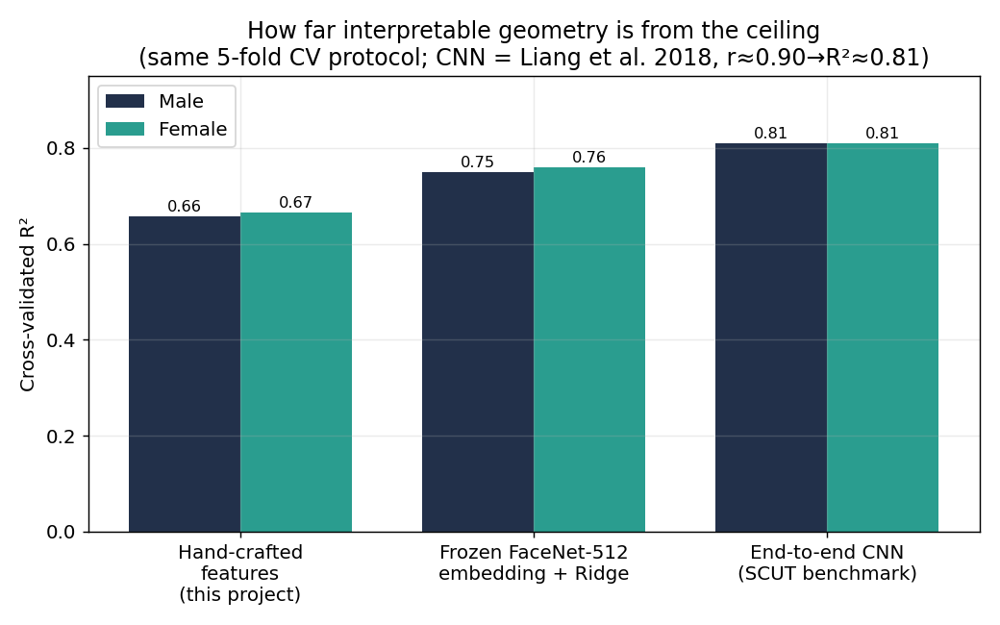
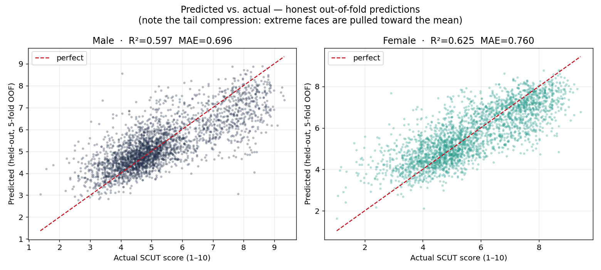
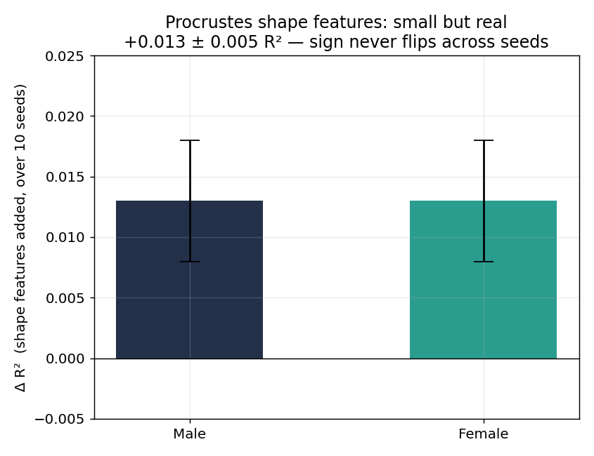
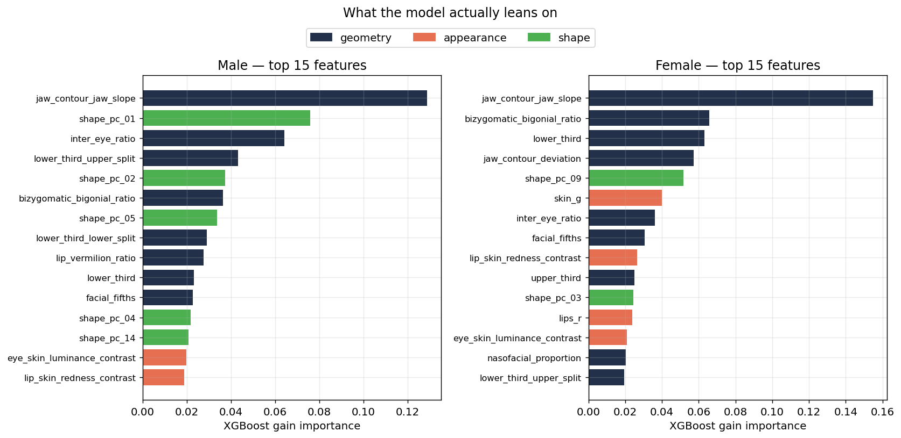
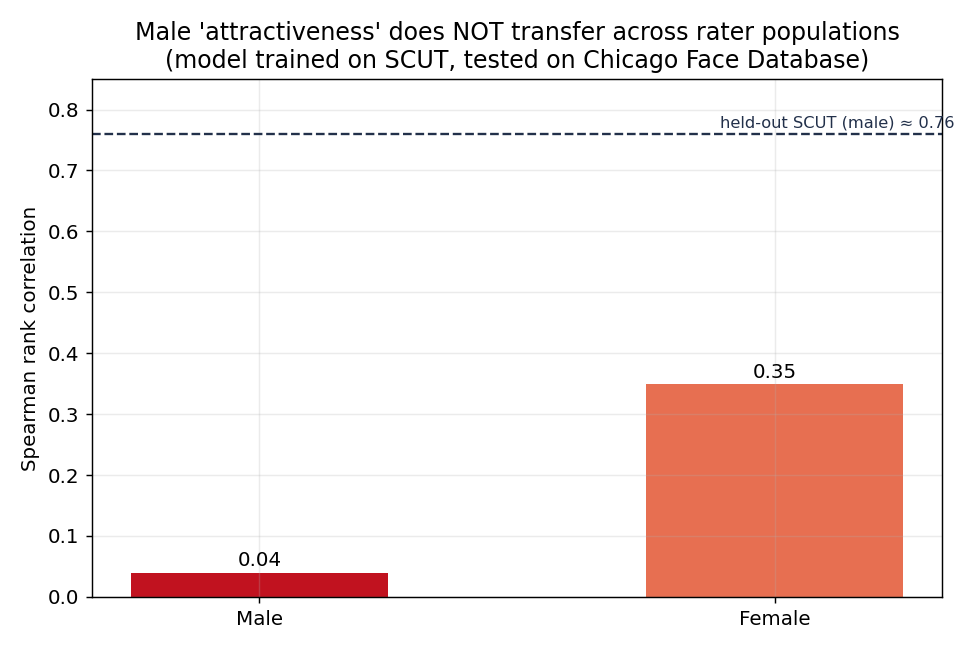
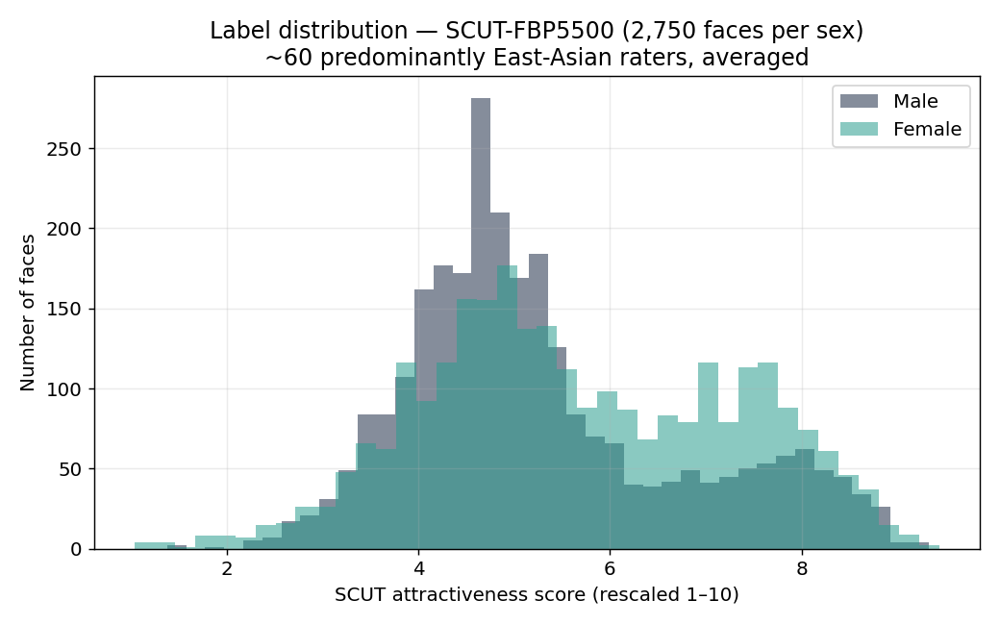

# Odin — How Far Can Interpretable Facial Geometry Go?

An end-to-end ML study of **how much of a subjective human rating can be explained by
named, hand-crafted facial features — and exactly where that breaks down.** Odin
extracts 478 facial landmarks with MediaPipe, turns them into 51 interpretable
features (classical proportions, colour/texture, Procrustes shape), trains per-sex
XGBoost regressors on the SCUT-FBP5500 dataset, and benchmarks the result against
face embeddings and published deep CNNs. It ships with a FastAPI + React UI that
explains every prediction feature-by-feature.

**Stack:** Python · MediaPipe · OpenCV · scikit-learn · XGBoost · NumPy/SciPy ·
FastAPI · React + TypeScript (Vite)

> ⚠️ **This is not a tool for measuring human attractiveness.** The "score" only
> reflects the averaged opinions of the ~60 raters who labelled SCUT-FBP5500
> (predominantly East-Asian faces) — one narrow, culturally specific snapshot of
> taste, not a standard. One of the project's main findings is precisely that these
> ratings **don't transfer** to another rater population (see below). Please don't
> base your self-image on anything here.

## Key results

| | Male R² | Female R² |
|---|---|---|
| **Odin — deployed, every feature named** | **0.633** | **0.636** |
| Odin — + unnamed PLS shape axes | 0.657 | 0.666 |
| Frozen FaceNet-512 embedding + Ridge | 0.749 | 0.759 |
| End-to-end CNN (SCUT-FBP5500 benchmark, ResNeXt-50) | ≈ 0.81 | ≈ 0.81 |

*5-fold cross-validation, 2,750 faces per sex, leakage-free (shape model refit per fold).*

- **Interpretable features hit a ceiling at ~0.63–0.66 R²**, and the *features* set it,
  not the model — bigger models and tuning never moved it. I measured the gap to the
  deep-learning ceiling instead of guessing it.
- **I deliberately gave up ~0.03 R²** to keep the model fully explainable: the extra
  lift came from shape axes that ablations showed were diffuse and un-nameable.
- **The labels are population-specific.** Trained on SCUT, the model ranks held-out
  SCUT males at Spearman ≈ 0.76 but a different population's males (Chicago Face
  Database) at **≈ 0.04 — essentially random**; females transfer moderately (≈ 0.35).
- **Every prediction is explainable.** Per-feature contributions (XGBoost TreeSHAP)
  sum exactly to the score, and the UI highlights the landmarks behind each ratio.



## Quickstart

Requires **Python 3.10+** (and **Node.js** for the web UI).

```bash
pip install -r requirements.txt
```

Download the MediaPipe face landmarker into `models/`:
<https://storage.googleapis.com/mediapipe-models/face_landmarker/face_landmarker/float16/1/face_landmarker.task>

**CLI:**
```bash
python -m Odin.main path/to/photo.jpg --sex male
# → Attractiveness (MALE): 7.64 / 10
#   Contributions per feature: {...}
```

**Web UI** — upload a photo and get the landmark overlay, every ratio (hover one to
highlight the landmarks it uses, with the male/female reference value beside it),
the per-feature contributions, and the score:
```bash
# backend (same Python env as the CLI)
pip install -r odin_ui/backend/requirements.txt
cd odin_ui/backend && uvicorn app:app --reload --port 8000

# frontend (new terminal)
cd odin_ui/frontend && npm install && npm run dev   # → http://localhost:5173
```
If the SCUT benchmark CNN weights are present in `pretrained_models/` (see
[Benchmark CNNs](#behaviour-vs-the-benchmark-cnns-out-of-distribution)), the UI shows
their scores next to Odin's; otherwise that panel is skipped.

## How it works

```
photo ──► MediaPipe FaceLandmarker (478 3-D landmarks) + hairline (trichion) detection
      ──► geometric ratios   (thirds, fifths, golden ratio, FWHR, jaw angles, eye aspect, …)
      ──► appearance         (skin texture, colour-unevenness, blemishes, lip/eye/skin colour, CIELab contrasts)
      ──► Procrustes shape   (averageness + ~7 named PLS shape axes per sex)
      ──► XGBoost regressor  ──► 1–10 score + per-feature contributions
```

Engineering details that mattered:

- **Train/inference parity.** Every feature is computed on pixel-space landmarks by
  the same code at training and inference time (ratios coincide with normalised
  coordinates only on square images like SCUT's). Each model is bundled with its
  feature order and fitted shape basis, so inference reproduces the exact vector.
- **Leakage-free evaluation.** The supervised shape model (PLS) is refit inside every
  CV fold; headline numbers are out-of-fold, and the ablations below are averaged
  over 10 seeds with paired comparisons.
- **Interpretability as a constraint, not an afterthought.** Every feature in the
  deployed model has a name; the shape axes kept are those that map to a describable
  deformation (e.g. *jaw angularity × face width-to-height*, the single top male
  feature).

## Findings in detail

**1. Model choice matters in a teachable way.** RandomForest, as a leaf-averaging
model, regresses the tails toward the mean — it literally can't rate an 8/10 face as
an 8. XGBoost's boosting follows the full curve, so RandomForest was dropped. Even
so, hand-crafted features compress the extremes:



**2. Supervised shape (PLS) is the biggest lever — but it resists naming.** Replacing
unsupervised shape-PCA with PLS (axes oriented toward the rating, not raw variance)
roughly doubles what shape contributes: averageness + 25 PLS axes add **+0.044
(female) / +0.065 (male) R²** over the ratios alone (10-seed out-of-fold; the sign
never flips), with ~0.03 of that being PLS beating PCA at equal axis count. But
leave-one-out said every axis was individually droppable, while dropping them as a
batch cost real R² — the lift is spread across many correlated axes that don't map to
nameable deformations. So the deployed model keeps only the ~7 named axes per sex.
PLS also closed the old gap between the sexes: male geometry, which had trailed
under PCA, now matches female.



**3. Hand-crafted skin descriptors barely move the needle.** To test whether the gap
to deep models is nameable skin texture waiting to be measured, I added
colour-unevenness (CIELab a\*/b\* spread) and a band-pass blemish detector. They add
only **+0.006 (female) / +0.005 (male) R²** — real (the sign holds) but negligible.
The remaining gap is holistic gestalt and photographic confounds, not features I
forgot to engineer.

**4. A generic embedding already holds most of the signal.** A *frozen* face-
recognition embedding (FaceNet-512) with a linear model reaches ~0.75 R² — about 94%
of the fine-tuned CNN ceiling. Most of the extractable signal lives in a generic face
representation, not in attractiveness-specific training.

**5. What the model leans on.** Geometry dominates, with Procrustes shape and
colour/texture contributing:



**6. The bias finding: male ratings don't transfer across rater populations.**



The data — SCUT-FBP5500 label distribution, 2,750 faces per sex, each averaged over
~60 raters:



All plots are aggregate statistics (no face images), reproducible with
`python plots/generate_plots.py` (needs the training cache, see below).

## Model performance

Per-sex models, 51 features, 5-fold CV, labels on a 1–10 scale (rescaled from SCUT's
1–5):

| Model | MAE | RMSE | R² |
|-------|-----|------|-----|
| Female | 0.742 | 0.968 | 0.636 ± 0.019 |
| Male (raw XGBoost) | 0.655 | 0.884 | 0.633 ± 0.010 |

To compare with the deep-CNN SCUT literature (≈ 0.21 MAE on 1–5), divide MAE by
2.25. The CNN reference is the official SCUT-FBP5500 benchmark (Liang et al., 2018):
ResNeXt-50 reports Pearson ≈ 0.90 (≈ 0.81 R²) under 5-fold CV, trained on all 5,500
faces pooled rather than per sex — so treat it as a ceiling reference, not a
like-for-like number.

A male-only **presentation boost** (`male_boost`) can stretch above-mean scores toward
a more intuitive scale. It intentionally trades fit against SCUT's raters, so it is a
display choice, not an accuracy improvement.

## Behaviour vs. the benchmark CNNs (out-of-distribution)

As a sanity check on unseen faces, I scored 60 faces — 10 attractive / 10 average /
10 unattractive per sex, from the Chicago Face Database (average/unattractive) and
web photos (attractive) — with Odin (raw, no boost) and the three published SCUT
benchmark CNNs (AlexNet, ResNet-18, ResNeXt-50), run through OpenCV's Caffe importer
(`benchmark_faces.py`, `pretrained_models/cnn_scorer.py`).

- **All four models rank the tiers correctly** (attractive > average > unattractive,
  both sexes).
- **Odin separates the tiers more** (+2.50 between attractive and unattractive means
  vs. +1.78–1.89 for the CNNs; std 1.34 vs ~1.0). The CNNs compress toward the middle
  on unfamiliar faces.
- **But Odin is systematically harsher at the bottom** (floor 2.6 vs. 3.8–4.5), and
  without ground-truth ratings there's no way to say whether that's right — it may
  simply be over-harsh.

Caveats: n = 10 per tier, the tiers are my own binning, and image size correlates with
score (r ≈ −0.7 for *every* model) because the attractive set were small web images —
an unavoidable confound in this test set. Suggestive behaviour, not a benchmark.

The CNN weights are third-party and not redistributed here; to reproduce, place the
`*.caffemodel` / `*_deploy.prototxt` files from the
[SCUT-FBP5500 release](https://github.com/HCIILAB/SCUT-FBP5500-Database-Release) in
`pretrained_models/`.

## Project structure

```
Odin/                          # inference pipeline: image → features → score
├── main.py                    #   CLI, build_features(), contributions, male_boost()
└── Face_analysis/
    ├── landmarks.py           #   MediaPipe Tasks landmark extraction
    ├── face_data.py           #   478 raw points → named semantic points
    ├── trichion.py            #   hairline detection (replaces MediaPipe's estimate)
    ├── constants.py           #   config, feature/boost constants
    ├── utils.py               #   angle helpers
    └── Ratios/
        ├── calculate_ratios.py    # classical geometric ratios
        ├── appearance.py          # colour / texture / CIELab contrast / blemish
        ├── regions.py             # sampling polygons (lips/eyes/cheeks/forehead)
        └── shape.py               # Procrustes alignment + shape features
odin_training/                 # training side (datasets NOT included — see below)
├── data_scut.py               #   SCUT feature extraction → CSV cache
├── extract_landmarks.py       #   one-time raw-landmark cache (for shape features)
├── shape_utils.py             #   generalised Procrustes + shape-PLS fitting
├── procrustes_features.py     #   shape-feature experiments and ablations
├── train.py                   #   XGBoost training, CV, bundle export
└── overlay.py                 #   debug region overlays
odin_ui/                       # web UI
├── backend/app.py             #   FastAPI wrapper around the exact Odin pipeline
└── frontend/                  #   Vite + React + TypeScript
facenet_cnn/                   # FaceNet-512 embedding + Ridge ceiling experiment
pretrained_models/cnn_scorer.py  # runs the SCUT benchmark CNNs via OpenCV DNN
benchmark_faces.py             # out-of-distribution comparison vs. the CNNs
plots/generate_plots.py        # all README figures
models/                        # trained per-sex XGBoost bundles (.joblib)
```

## Reproducing the training

Training needs the SCUT-FBP5500 dataset (not included) placed under
`odin_training/scut/` (`Images/` and `All_Ratings.xlsx`), plus `openpyxl`,
`matplotlib` and `seaborn`.

```bash
cd odin_training
python extract_landmarks.py   # one-time raw-landmark cache
python data_scut.py           # feature extraction → training_data_scut.csv
python train.py               # CV report + 51-feature bundles in models/
```

The FaceNet ceiling experiment (`facenet_cnn/`) additionally needs `deepface`.

## Using the model in another project

A `.joblib` bundle is **not** self-contained: a prediction is only valid if the input
features come from this exact pipeline (same landmarks, pixel scaling, hairline
detection, ratio definitions, shape basis and column order). Copy `Odin/` and
`models/` together.

Each bundle is a dict: `xgboost`, `feature_names` (required column order), `label`,
`target`, `n_samples`, male calibration stats `xgb_pred_mean` / `xgb_pred_max`, and the
shape model `shape_ref_mean` / `shape_pls` (a fitted `PLSRegression`). The shape step
computes all 25 PLS axes; unnamed ones are dropped by reindexing on `feature_names`.

```python
import joblib, pandas as pd
from Odin.Face_analysis.landmarks import calculate_landmarks_array
from Odin.Face_analysis.face_data import extract_face_data
from Odin.Face_analysis.trichion import apply_trichion
from Odin.Face_analysis.Ratios.appearance import appearance_features
from Odin.main import build_features, add_shape_features, male_boost

landmarks, img = calculate_landmarks_array("photo.jpg")
h, w = img.shape[:2]
px = landmarks.copy(); px[:, 0] *= w; px[:, 1] *= h; px[:, 2] *= w  # pixel space

face_data = extract_face_data(px)
appearance = appearance_features(img, px)
apply_trichion(face_data, img)                        # detected hairline, as in training

model = joblib.load("models/model_male.joblib")
features = build_features(face_data, appearance)
add_shape_features(features, px, model)               # Procrustes features
X = pd.DataFrame([features], columns=model["feature_names"])

score = float(model["xgboost"].predict(X)[0])
if model["label"] == "MALE":                          # optional presentation boost
    score = male_boost(score, model)
print(round(score, 2))
```

## Data & ethics

The SCUT-FBP5500 dataset and the Chicago Face Database (used only for the
cross-population analysis) are **not included** — they are photographs of real people
under academic-use terms, and redistributing them would be a licensing and privacy
violation. Only code, aggregate plots and the trained models are published. The
ratings are subjective judgments from a specific, non-representative rater pool, and
the transfer result above shows how little they generalise — treat every number here
as a property of that dataset, not of faces.

## Dataset citations

If you retrain or build on this work, cite the original datasets.

**SCUT-FBP5500** — primary training data:

> Liang, L., Lin, L., Jin, L., Xie, D., & Li, M. (2018). SCUT-FBP5500: A Diverse
> Benchmark Dataset for Multi-Paradigm Facial Beauty Prediction. *2018 24th
> International Conference on Pattern Recognition (ICPR)*, 1598–1603.
> https://doi.org/10.1109/ICPR.2018.8546038

```bibtex
@inproceedings{liang2018scutfbp5500,
  title        = {{SCUT-FBP5500}: A Diverse Benchmark Dataset for Multi-Paradigm Facial Beauty Prediction},
  author       = {Liang, Lingyu and Lin, Luojun and Jin, Lianwen and Xie, Duorui and Li, Mengru},
  booktitle    = {2018 24th International Conference on Pattern Recognition (ICPR)},
  pages        = {1598--1603},
  year         = {2018},
  organization = {IEEE},
  doi          = {10.1109/ICPR.2018.8546038}
}
```

**Chicago Face Database (CFD)** — cross-population transfer analysis only (not
shipped, not used to train the models). Per the CFD usage terms:

> CFD: Ma, D. S., Correll, J., & Wittenbrink, B. (2015). The Chicago Face Database:
> A Free Stimulus Set of Faces and Norming Data. *Behavior Research Methods, 47*,
> 1122–1135. https://doi.org/10.3758/s13428-014-0532-5
>
> CFD-INDIA: Lakshmi, A., Wittenbrink, B., Correll, J., & Ma, D. S. (2021). The
> India Face Set: International and Cultural Boundaries Impact Face Impressions and
> Perceptions of Category Membership. *Frontiers in Psychology, 12*, 627678.
> https://doi.org/10.3389/fpsyg.2021.627678
>
> CFD-MR (if you use the multiracial expansion): Ma, D. S., Kantner, J., &
> Wittenbrink, B. (2021). Chicago Face Database: Multiracial Expansion. *Behavior
> Research Methods, 53*, 1289–1300. https://doi.org/10.3758/s13428-020-01482-5

## License

Code is released under the Apache 2.0 license (see `LICENSE` and `NOTICE`). The
ratios themselves come from public facial-aesthetics literature and are not owned by
this project.
